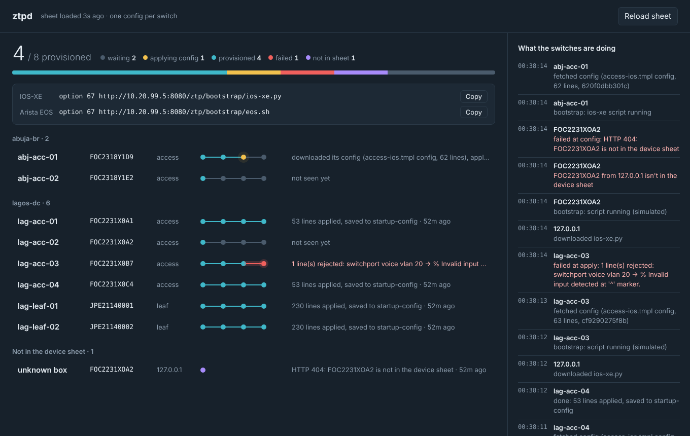

# ztpd

Zero-touch provisioning for switches. Rack a new Cisco IOS-XE or Arista EOS switch, plug in the uplink, power it on. It gets an address from DHCP, downloads a bootstrap script from ztpd, sends its serial number, gets a config rendered from your templates and its row in a spreadsheet, applies it, and reports back. You watch it happen on a dashboard.



*A rollout in progress: 4 switches done, one applying its config, one rejected a line, one waiting, and one box whose serial isn't in the sheet (someone typed the letter O instead of zero).*

## Why

Provisioning switches by hand means a console cable, a laptop, a text file of config, and a lot of find-and-replace for hostnames and IPs. At switch number 30 someone pastes lag-acc-02's management IP onto lag-acc-03, and you find out from the duplicate-IP alarm.

The vendors' own tools (Cisco DNA Center, Arista CloudVision) do this well, but they're licensed platforms. For a rollout of a few dozen switches I wanted something you can run on any Linux box in the management VLAN: the data comes from the rack-and-stack sheet people already fill in, the configs come from templates in git, and every step a switch takes is logged.

## How it works

```
 switch boots, no config
   │  DHCP: address + option 67 = http://ztpd:8080/ztp/bootstrap/ios-xe.py
   ▼
 GET  /ztp/bootstrap/ios-xe.py      the script (Python for IOS-XE guestshell, bash for EOS)
 POST /ztp/report/FOC2231X0A1       "bootstrap: script running"
 GET  /ztp/config/FOC2231X0A1       config rendered for this serial (404 if it's not in the sheet)
      the script applies it          IOS-XE: line by line, collecting rejected lines
                                     EOS: written to startup-config, then reboot
 POST /ztp/report/FOC2231X0A1       "applied: 53 lines" or "apply failed: <the line and the error>"
```

The **serial number** connects a box to its row in the sheet, because it's printed on the box and on the delivery note. Nobody has to know the MAC address before the switch arrives.

## The inputs

**`devices.csv`**: one row per switch. `serial`, `hostname` and `role` are required. **Every other column becomes a template variable**, so adding `rack` or `uplink_port` to the sheet makes `{{.rack}}` work with no code change.

```csv
serial,hostname,role,site,mgmt_ip,asn,loopback,spine1_ip,spine2_ip,rack
JPE21140001,lag-leaf-01,leaf,lagos-dc,10.20.99.21/24,65101,10.255.0.11/32,10.0.1.0,10.0.2.0,B04
FOC2231X0A1,lag-acc-01,access,lagos-dc,10.20.99.31/24,,,,,B01
```

**`inventory.json`**: defaults, sites and roles. A role picks the template and platform. Variables merge as **defaults < role < site < the device's own columns**.

**`templates/*.tmpl`**: Go templates, all parsed together so they can share blocks (see `base-ios.tmpl`). Helpers for the arithmetic network configs always need:

| | `"10.20.99.31/24"` → |
|---|---|
| `{{ip .mgmt_ip}}` | `10.20.99.31` |
| `{{mask .mgmt_ip}}` | `255.255.255.0` |
| `{{wildcard .mgmt_ip}}` | `0.0.0.255` |
| `{{network .mgmt_ip}}` | `10.20.99.0` |
| `{{nthhost .mgmt_ip 1}}` | `10.20.99.1` (the gateway) |
| `{{range seq 1 .access_ports}}` | 1 … 48 |
| `{{join "," (vlanids .vlans)}}` | `10,20,30,99` |
| `{{env "ZTP_ENABLE_SECRET"}}` | from the environment |

**Secrets don't go in git.** They come from environment variables, and an unset one is an error: ztpd won't serve a config containing `enable secret ` with nothing after it. The same goes for any variable a template uses that a device doesn't have, which ztpd reports as *"template needs rack, which this device doesn't have"* instead of rendering an empty string.

See [`examples/`](examples/): two Arista leafs with BGP to two spines over /31s, and six Cisco access switches across two sites.

## Catch mistakes before the switch is in the rack

```
$ ztpd check
ok   abj-acc-01     FOC2318Y1D9  access-ios.tmpl    62 lines
ok   lag-leaf-01    JPE21140001  leaf-eos.tmpl     242 lines
...
all 8 devices render
```

`check` renders every device and flags problems in the sheet: duplicate serials, duplicate hostnames, **the same management IP on two switches**, an unknown role or site, an IP without a prefix length. It exits 1 if anything is wrong, so you can run it in CI on the repo that holds your inventory. The same checks show on the dashboard as "things to fix before these switches boot".

`ztpd render -serial lag-leaf-01` prints one config, so you can review it before the switch arrives.

## Run it

```
go install github.com/GreatsLab/ztpd@latest
cd examples
export ZTP_ADMIN_SECRET='...' ZTP_ENABLE_SECRET='...' ZTP_SNMP_RO='...' ZTPD_TOKEN='...'
ztpd serve -url http://10.20.99.5:8080 -allow 10.20.99.0/24,10.30.99.0/24 -once
```

| flag | |
|---|---|
| `-url` | the address the switches use to reach ztpd; it's baked into the bootstrap script |
| `-allow` | only these networks can fetch configs (they contain secrets). The dashboard isn't limited. |
| `-once` | after a switch reports success, refuse to serve its config again until someone **re-arms** it from the dashboard. This stops a switch that reboots back into ZTP from being reset to day-0 config. |
| `-log` | the event log (JSONL). It's replayed on start, so a restart doesn't forget which switches are done. |
| `ZTPD_TOKEN` | needed for reload, re-arm and viewing configs in the dashboard |

`kill -HUP` (or the "Reload sheet" button) re-reads the sheet and templates. A sheet with one bad row still loads: the bad row is left out and listed, so one typo doesn't stop the other forty switches.

Docker: `docker build -t ztpd . && docker run -p 8080:8080 --env-file secrets.env -v $PWD/my-inventory:/etc/ztpd -v ztpd:/data ztpd`. There's also a systemd unit in [`deploy/`](deploy/ztpd.service).

### DHCP

Point option 67 at the bootstrap for the platform. Cisco IOS DHCP server:

```
ip dhcp pool ZTP-MGMT
 network 10.20.99.0 255.255.255.0
 default-router 10.20.99.1
 option 67 ascii http://10.20.99.5:8080/ztp/bootstrap/ios-xe.py
```

dnsmasq:

```
dhcp-range=10.20.99.100,10.20.99.199,1h
dhcp-option=option:router,10.20.99.1
dhcp-option=67,"http://10.20.99.5:8080/ztp/bootstrap/eos.sh"
```

With both vendors on one VLAN, use your DHCP server's client classes to give each one its own script.

## Try it without switches

`simulate` does what the bootstrap scripts do on a real switch:

```
ztpd simulate -server http://127.0.0.1:8080 -spread 30s -fail FOC2231X0B7 -unknown 1
```

It boots every waiting device over 30 seconds, makes one fail to apply its config, and adds a switch that isn't in the sheet. CI runs a full simulated rollout of the example network and checks that all 8 switches end up provisioned and that `-once` refuses a second fetch.

## Tests

`go test -race ./...`: merge order, sheet validation, template helpers including /31 and /32 masks, missing variables, path traversal in template names, the whole provisioning flow over HTTP, unknown serials, failed applies, `-once` and re-arm, the allow list, event-log replay after a restart, and a switch that arrives before its row was added.

## Bugs I hit while building it

- **`seq 1 .server_ports` failed with "expected int; got float64".** JSON numbers decode as float64 and CSV columns arrive as strings, so `seq` now accepts any of them (but rejects 2.5 ports).
- **The unknown switch disappeared from the dashboard.** After the 404 the bootstrap script reports "config failed", which moved the box to *failed*, and the "not in the sheet" list only showed devices still marked *unknown*. Anything not in the sheet is now unknown, whatever it last reported.
- **Blank lines everywhere** in the rendered configs, left by `{{range}}` and `{{define}}`. The renderer now drops them, because `!` is the separator a config actually uses.
- **Configs rendered fine on my laptop and failed on the server.** The secrets were exported in my shell but not in the service's environment. That's why a missing `env` value is now an error with its name in it, rather than an empty password.

## Not done yet

- NX-OS POAP script
- Upgrade the OS image first when the switch is below a minimum version
- Push the finished switch into [ipamd](https://github.com/GreatsLab/ipamd) and the monitoring system

## License

MIT
